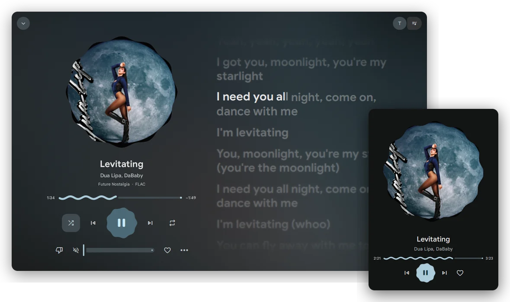
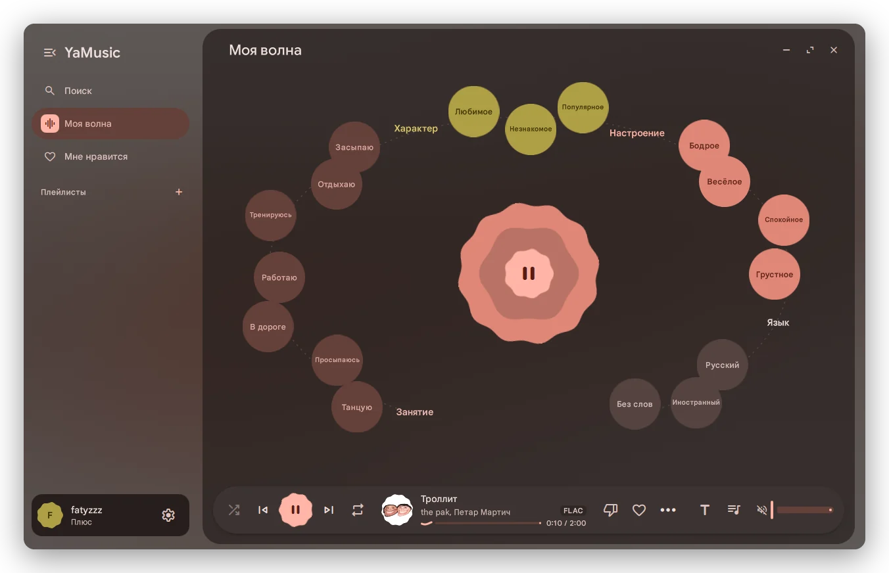
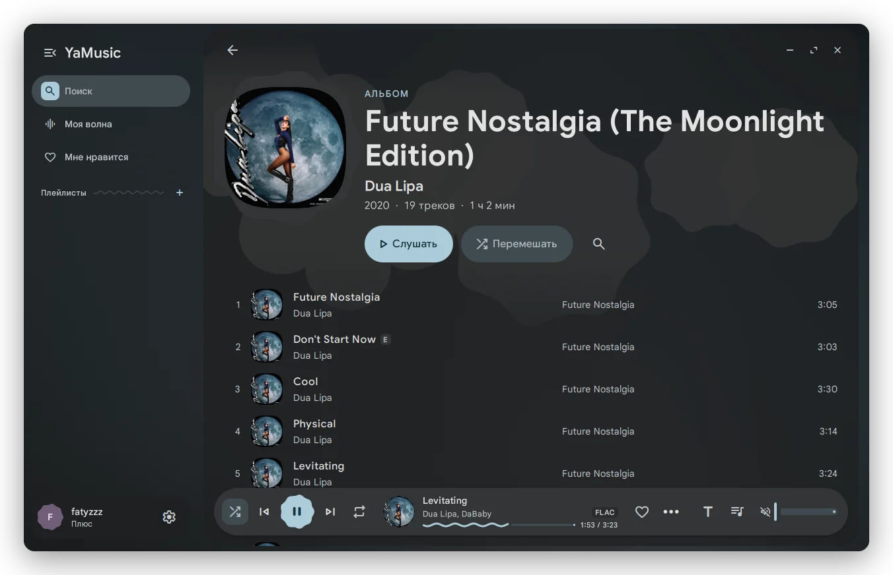
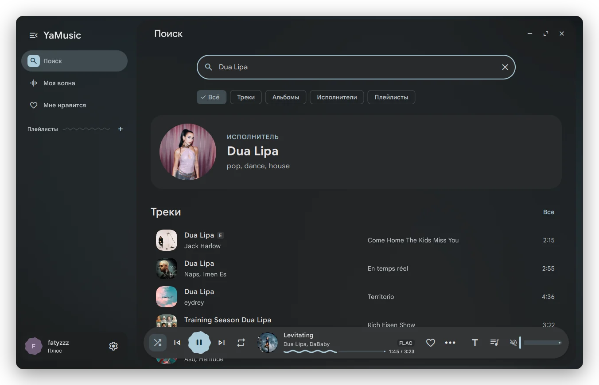
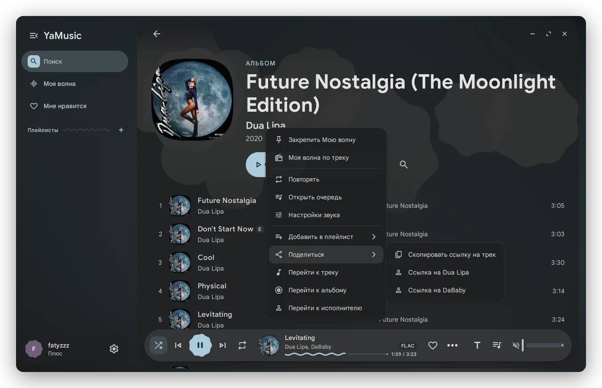
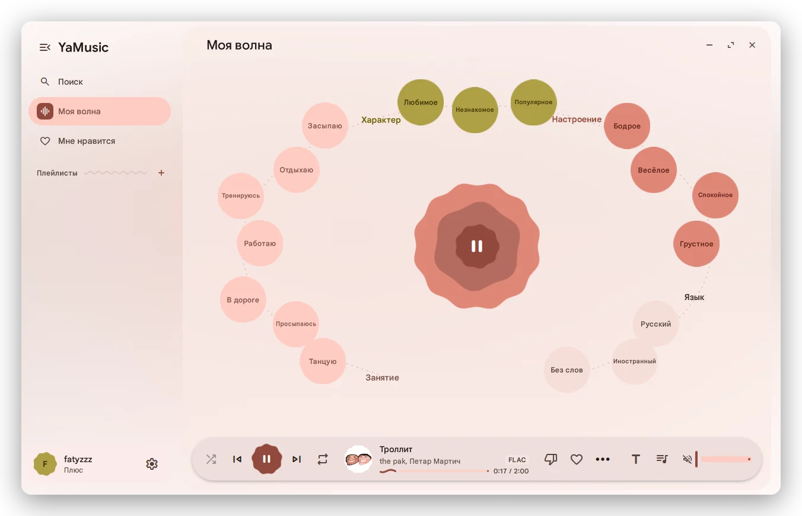
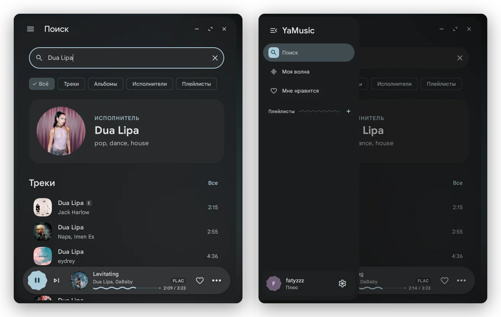
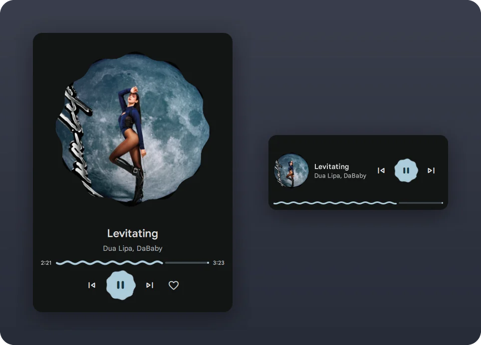
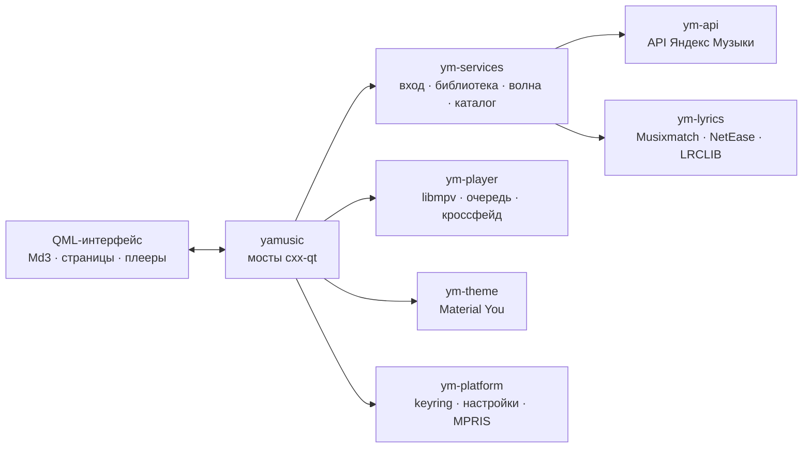

<div align="center">


# YaMusic

**Неофициальный клиент Яндекс Музыки в стиле Material 3 Expressive**<br>
Linux · Windows · Android — тема перекрашивается под обложку каждого трека

[](https://github.com/yaskorinov/yamusic-md3/releases)
[](https://github.com/yaskorinov/yamusic-md3/releases)
[](https://github.com/yaskorinov/yamusic-md3/actions/workflows/release.yml)
<br>


[**Скачать**](https://github.com/yaskorinov/yamusic-md3/releases/latest) ·
[Возможности](#возможности) ·
[Скриншоты](#скриншоты) ·
[Установка](#установка) ·
[Горячие клавиши](#горячие-клавиши) ·
[Сборка](#сборка-из-исходников)

<br>



</div>

<br>

## Возможности

<table>
<tr>
<td width="50%" valign="top">

### 🎨 Цвет из обложки
Material You на каждый трек: схема строится по обложке и меняется вместе с ней — шторкой, волной от
обложки, растворением или перетеканием. Семь вариантов схемы, светлая и тёмная тема, фон из размытой
обложки (мягкое размытие, матовое стекло, градиент, пятна).

</td>
<td width="50%" valign="top">

### 🌊 Моя волна
Настройки волны летают по орбите вокруг кнопки: занятие, характер, настроение, язык — выбранная
прилипает к центру и меняет его форму и цвет. В тесном окне орбита превращается в группы чипов.
Волна по любому треку прямо из меню.

</td>
</tr>
<tr>
<td valign="top">

### 🎤 Текст в такт
Синхронный текст по словам (Musixmatch, NetEase) и по строкам (LRCLIB, Яндекс): строка подсвечивается,
текст можно листать, клик по строке — перемотка. Для LRCLIB выбирается разметка, на которой сходится
большинство записей нужной длительности.

</td>
<td valign="top">

### 🎧 Звук
libmpv, lossless FLAC при подписке, плавный переход между треками (кроссфейд) или без пауз (gapless),
восстановление очереди и позиции после перезапуска. Обложка «дышит» в такт музыке.

</td>
</tr>
<tr>
<td valign="top">

### 🪟 От мини-плеера до полного экрана
Окно сжимается до 280×120: полная раскладка → компактная (сайдбар — шторкой) → мини-плеер карточкой
или полоской, с громкостью колесом и закреплением поверх всех окон. Переходы между раскладками плавные,
размер и положение окна запоминаются.

</td>
<td valign="top">

### 🖱️ Меню трека
ПКМ или «⋯» на любом треке: закрепить волну, волна по треку, повтор, очередь, добавить в плейлист,
поделиться ссылкой, перейти к треку, альбому или исполнителю. Меню — отдельное окно и выходит за
границы маленького плеера.

</td>
</tr>
<tr>
<td valign="top">

### 💻 Как родное
MPRIS на Linux, значок в трее (закрытие окна прячет плеер — музыка играет дальше), медиаклавиши,
один экземпляр. На Windows — своя рамка с Aero Snap и плавным ресайзом, инсталлер без прав администратора.

</td>
<td valign="top">

### 📱 Android
Отдельный нативный клиент на Kotlin и Jetpack Compose с тем же дизайном: волна, коллекция, поиск,
тексты, фон из обложки, скачивание для игры без сети.

</td>
</tr>
</table>

## Скриншоты

<table>
<tr>
<td width="50%"><p align="center"><sub>«Моя волна» — настройки на орбите</sub></p></td>
<td width="50%"><p align="center"><sub>Страница альбома</sub></p></td>
</tr>
<tr>
<td><p align="center"><sub>Поиск</sub></p></td>
<td><p align="center"><sub>Меню трека по ПКМ</sub></p></td>
</tr>
<tr>
<td><p align="center"><sub>Светлая тема</sub></p></td>
<td><p align="center"><sub>Компактная раскладка</sub></p></td>
</tr>
</table>

<p align="center"><br><sub>Мини-плеер: карточка и полоска</sub></p>

## Установка

| Платформа | Файл | |
|---|---|---|
| **Windows** 10/11 x64 | `YaMusic-<версия>-Setup.exe` | инсталлер без прав администратора; есть и портативный `.zip` |
| **Linux** x86_64 | `YaMusic-<версия>-x86_64.AppImage` | или сборка из исходников одной командой |
| **Android** 13+ | `YaMusic-<версия>-android.apk` | отдельный нативный клиент |
| macOS | `YaMusic-<версия>-macos-*.dmg` | экспериментально, сборка «как получится» |

Всё лежит на странице [**Releases**](https://github.com/yaskorinov/yamusic-md3/releases/latest).

> [!TIP]
> **Вход.** При первом запуске откройте «Аккаунт» — программа покажет код, его нужно ввести на
> [ya.ru/device](https://ya.ru/device) под своим аккаунтом Яндекса. Пароль программе не нужен.

### Windows

Скачайте `YaMusic-<версия>-Setup.exe` и запустите. Программа ставится в `%LocalAppData%\Programs\YaMusic`
без UAC, добавляет значок в меню «Пуск» (по желанию — на рабочий стол и в автозапуск) и появляется в
«Программы и компоненты». Новая версия ставится поверх старой, настройки и вход сохраняются.

Инсталлер не подписан, поэтому SmartScreen может предупредить: «Подробнее» → «Выполнить в любом случае».
Без установки — `YaMusic-<версия>-windows-x64-portable.zip`: распакуйте и запустите `yamusic.exe`.

### Linux

**AppImage** — всё нужное внутри, включая Qt и libmpv:

```bash
chmod +x YaMusic-*-x86_64.AppImage
./YaMusic-*-x86_64.AppImage
```

**Сборка из исходников одной командой** (x86_64 или aarch64):

```bash
curl -fsSL https://raw.githubusercontent.com/yaskorinov/yamusic-md3/main/install.sh | bash
```

Скрипт поставит недостающие системные пакеты (спросит разрешение и пароль sudo), скачает программу в
`~/.local/share/yamusic-md3`, поставит Rust через [rustup](https://rustup.rs) без sudo, возьмёт системный Qt,
если он 6.12 или новее, а иначе скачает Qt 6.12 туда же, соберёт программу и добавит команду `yamusic` и
значок в меню. Первая сборка — 5–15 минут и около 3 ГБ на время сборки.

- **Обновление** — та же команда ещё раз.
- **Удаление** — `bash ~/.local/share/yamusic-md3/install.sh --uninstall` (настройки и вход остаются).

> [!NOTE]
> На Wayland нет «поверх всех окон», а положение окна выбирает композитор — эти пункты там скрыты,
> размер окна запоминается как обычно.

### Android

Скачайте `YaMusic-<версия>-android.apk` и установите (Android 13 и новее). Вход — так же, по коду на ya.ru/device.

## Горячие клавиши

| Клавиши | Действие |
|---|---|
| <kbd>Space</kbd> | играть / пауза |
| <kbd>Ctrl</kbd> + <kbd>→</kbd> / <kbd>←</kbd>, медиаклавиши | следующий / предыдущий трек |
| <kbd>Ctrl</kbd> + <kbd>↑</kbd> / <kbd>↓</kbd> | громкость |
| <kbd>Shift</kbd> + <kbd>→</kbd> / <kbd>←</kbd> | перемотка на 10 с |
| <kbd>Ctrl</kbd> + <kbd>P</kbd> | полноэкранный плеер |
| <kbd>Ctrl</kbd> + <kbd>L</kbd> | текст песни |
| <kbd>Ctrl</kbd> + <kbd>F</kbd> | поиск (в списке треков — сначала по списку) |
| <kbd>Ctrl</kbd> + <kbd>B</kbd> | свернуть / развернуть сайдбар |
| <kbd>Ctrl</kbd> + <kbd>,</kbd> | настройки |
| <kbd>Alt</kbd> + <kbd>←</kbd>, кнопка мыши «назад» | назад |
| <kbd>F11</kbd> | на весь экран |
| <kbd>Ctrl</kbd> + <kbd>Q</kbd> | выход |

**В мини-плеере:** <kbd>←</kbd> / <kbd>→</kbd> — трек, <kbd>↑</kbd> / <kbd>↓</kbd> и колесо мыши — громкость,
двойной клик — развернуть, <kbd>Shift</kbd> при наведении — булавка «поверх всех окон», ПКМ — меню с
повтором, перемешиванием и прочим.

## Как устроено

Интерфейс — QML на Qt 6.12 со своей библиотекой компонентов Material 3 Expressive (`src/yamusic/qml/Md3`),
ядро — Rust-workspace, связанный с QML через [cxx-qt](https://github.com/KDAB/cxx-qt).



| Крейт | Что делает |
|---|---|
| `ym-api` | клиент API: OAuth по коду, каталог, лайки, плейлисты, ротор «Моей волны», ссылки на файлы с подписью, расшифровка lossless |
| `ym-player` | libmpv (подгружается во время работы), очередь, кроссфейд, gapless, сессия |
| `ym-theme` | схемы Material You из обложки или своего цвета |
| `ym-lyrics` | тексты из нескольких источников, разбор LRC, кэш |
| `ym-services` | вход, библиотека, каталог, волна, учёт прослушиваний |
| `ym-platform` | токен в системной связке ключей, настройки, MPRIS, один экземпляр |
| `yamusic` | бинарь: мосты в QML, CLI, кэш картинок, нативная рамка окна на Windows |

Подробнее — [docs/SPEC.md](docs/SPEC.md) и [docs/RUST_CONTRACT.md](docs/RUST_CONTRACT.md).

## Сборка из исходников

Нужны **Rust** 1.98+ ([rustup](https://rustup.rs); на Windows — toolchain `stable-x86_64-pc-windows-msvc`),
**Qt 6.12** с qtdeclarative, qtsvg, qtshadertools, qtimageformats (и qtwayland на Linux) — через Qt Online
Installer или скриптом `.github/scripts/install_qt.py`, который качает архивы прямо с download.qt.io (им же
пользуется CI), и **libmpv** — она подгружается во время работы, для сборки не нужна.

cxx-qt находит Qt по переменной `QMAKE` (путь к `qmake6`). Готовый `yamusic` сам находит QML и ресурсы:
`$YAMUSIC_QML_DIR`, иначе `qml/` рядом с exe, иначе `src/yamusic/qml` в репозитории — поэтому `cargo run`
работает прямо из исходников.

<details>
<summary><b>Linux</b></summary>

```bash
# Debian/Ubuntu; для Arch: sudo pacman -S base-devel lld mpv 7zip
sudo apt install build-essential pkg-config lld python3 7zip libmpv-dev libgl-dev libegl-dev \
    libxkbcommon-dev libfontconfig1-dev libxcb-cursor0 libxkbcommon-x11-0

python3 .github/scripts/install_qt.py --out ~/Qt/6.12.0/gcc_64
export QMAKE=~/Qt/6.12.0/gcc_64/bin/qmake6 LD_LIBRARY_PATH=~/Qt/6.12.0/gcc_64/lib

cargo run --release -p yamusic              # приложение
cargo run --release -p yamusic -- --gallery # галерея компонентов MD3
```

cxx-qt не линкуется GNU ld.bfd — нужен `lld`, `mold` или `gold`. AppImage и `tar.gz`:
`bash .github/scripts/package_linux.sh 0.3.0` → `target/dist/`.

</details>

<details>
<summary><b>Windows</b></summary>

Нужны [Build Tools for Visual Studio 2022](https://visualstudio.microsoft.com/visual-cpp-build-tools/)
(«Разработка классических приложений на C++»), Rust (msvc), Qt 6.12 `msvc2022_64`, PowerShell 7 и, для
инсталлера, [Inno Setup 6](https://jrsoftware.org/isinfo.php) (`winget install JRSoftware.InnoSetup`).

```powershell
python .github\scripts\install_qt.py --out C:\Qt\6.12.0\msvc2022_64   # если Qt ещё нет
.\build_windows.ps1 -QtDir C:\Qt\6.12.0\msvc2022_64
```

Скрипт соберёт `cargo build --release`, разложит в `target\dist\yamusic\` exe, `qml\`, `assets\`, Qt
(windeployqt), рантайм MSVC и `libmpv-2.dll` (из корня репозитория или свежую из
[shinchiro/mpv-winbuild-cmake](https://github.com/shinchiro/mpv-winbuild-cmake/releases)) и соберёт
`target\dist\YaMusic-<версия>-Setup.exe`. Ключи: `-SkipInstaller`, `-Portable` (ещё и `.zip`),
`-SkipBuild`, `-CargoProfile debug`, `-MpvDll путь`, `-Version 1.2.3`.

Для разработки без упаковки:

```powershell
$env:QMAKE = "C:\Qt\6.12.0\msvc2022_64\bin\qmake6.exe"
$env:PATH = "C:\Qt\6.12.0\msvc2022_64\bin;$env:PATH"   # Qt DLL
cargo run -p yamusic                                     # libmpv-2.dll — из корня репозитория
```

</details>

<details>
<summary><b>macOS</b> (экспериментально)</summary>

```bash
brew install mpv dylibbundler sevenzip
python3 .github/scripts/install_qt.py --out ~/Qt/6.12.0/macos
export QMAKE=~/Qt/6.12.0/macos/bin/qmake6
cargo build --release -p yamusic
bash .github/scripts/package_macos.sh 0.3.0   # target/dist/YaMusic.app и .dmg
```

</details>

<details>
<summary><b>Android</b></summary>

Нужны JDK 21 и Android SDK.

```bash
cd android && ./gradlew :app:assembleDebug
adb install -r app/build/outputs/apk/debug/app-debug.apk
```

Устройство клиента — в [docs/SPEC.md](docs/SPEC.md), раздел «Android».

</details>

<details>
<summary><b>Ключи запуска и переменные</b></summary>

- Ключи: `--gallery`, `--offline`, `--new-instance`, `--light`, `--size 1280x800`, `--screenshot shot.png`.
- Переменные: `YAMUSIC_QML_DIR` (свой каталог QML), `YAMUSIC_LIBMPV` (путь к libmpv), `YAMUSIC_AO`
  (аудиовыход mpv), `RUST_LOG` (журнал, например `RUST_LOG=yamusic=debug`).
- Прежняя версия ядра на Python (PySide6) пока лежит в `src/yamusic/*.py` и запускается `uv run yamusic`.

</details>

## CI и выпуски

- [`build.yml`](.github/workflows/build.yml) — на PR в `main` и вручную (Actions → Build → Run workflow):
  Linux (AppImage, tar.gz), Windows (инсталлер, portable), macOS (best effort), Android (APK). Готовые файлы —
  в артефактах запуска.
- [`release.yml`](.github/workflows/release.yml) — на тег `v*` (`git tag v0.3.0 && git push --tags`): те же
  сборки и публикация в GitHub Release с `SHA256SUMS.txt`. Тег с дефисом (`v0.3.0-rc1`) — пред-выпуск.
- Подписанный APK собирается, если в секретах репозитория есть `ANDROID_KEYSTORE_BASE64`
  (`base64 -w0 release.jks`), `ANDROID_KEYSTORE_PASSWORD`, `ANDROID_KEY_ALIAS`, `ANDROID_KEY_PASSWORD`;
  без них публикуется отладочный APK.

## Благодарности

- [Google Sans](https://fonts.google.com/specimen/Google+Sans) — SIL Open Font License 1.1
- [Material Symbols Rounded](https://github.com/google/material-design-icons) — Apache License 2.0
- [cxx-qt](https://github.com/KDAB/cxx-qt), [mpv](https://mpv.io), [LRCLIB](https://lrclib.net),
  [yandex-music-api](https://github.com/MarshalX/yandex-music-api) — на него опирается разбор API

<br>

<p align="center"><sub>Клиент использует неофициальный API Яндекс Музыки и не связан с Яндексом.</sub></p>
